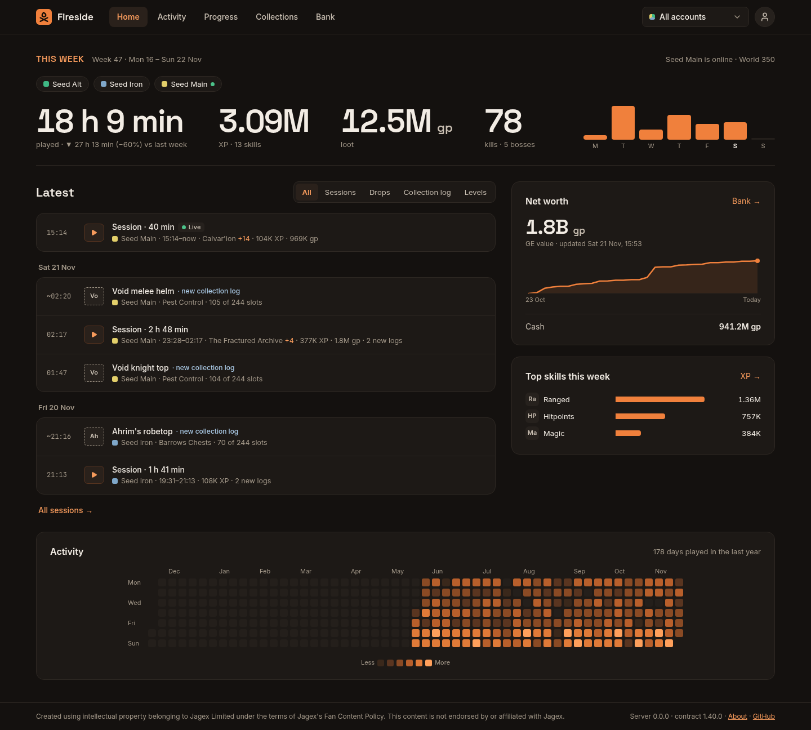
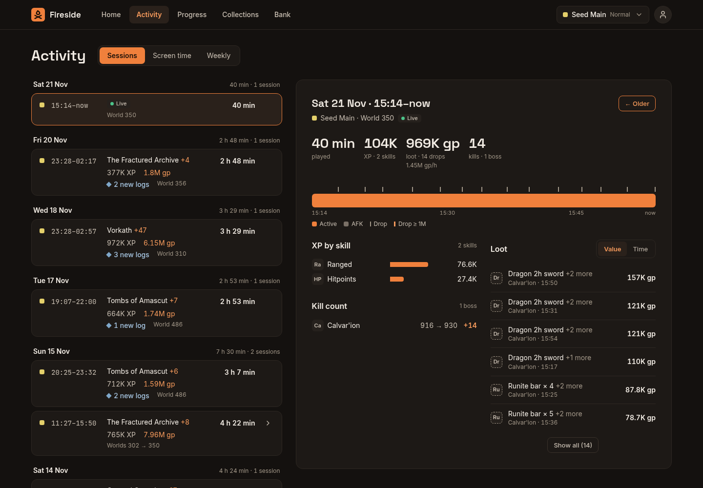
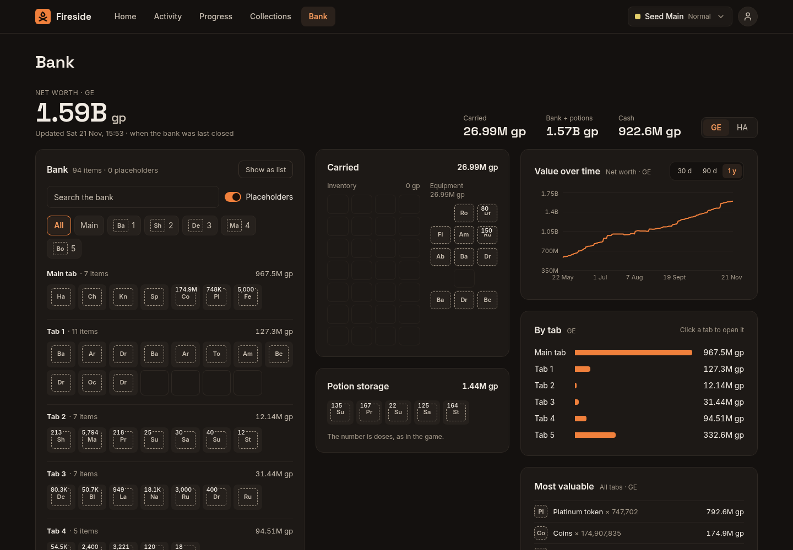
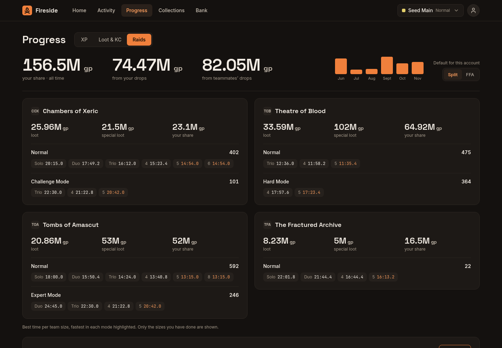
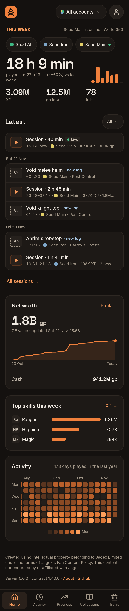

# Fireside

A self-hosted tracker for Old School RuneScape. A RuneLite plugin collects
your own data (sessions, screen time, XP, loot, kill counts, raids, bank,
quests, diaries, pets) for one or more accounts and sends it to a Fireside
server, which shows it on your own dashboard.

You run the server yourself, on your own computer, or a friend you trust runs
one for a few people. Each instance can have several users, who join by
invite only, and each user only sees their own accounts. There is no public
or central Fireside service.

Website: https://fireside.tools

## Screenshots

Simulated data from `pnpm seed`, with placeholder icons. Real item, skill and
boss icons only ever come from your own game client, into your own database.

| Home                                                                                                                        | Sessions                                                                                       |
| --------------------------------------------------------------------------------------------------------------------------- | ---------------------------------------------------------------------------------------------- |
|  |  |

| Bank                                                                                                             | Raids                                                                                                            |
| ---------------------------------------------------------------------------------------------------------------- | ---------------------------------------------------------------------------------------------------------------- |
|  |  |

On a phone:



## Features

- **Activity:** sessions with world hops and AFK periods, screen time per day
  and week, and a weekly summary.
- **Progress:** XP and levels over time, quests and achievement diaries.
- **Collections:** loot and kill counts with personal bests, raids (purples,
  completions, best times and a split tracker), pets, and the collection log
  (optional, through RuneProfile).
- **Bank:** the bank as the game shows it, potion storage, what you carry,
  and net worth over time (optionally at current prices from the OSRS Wiki).
- Several OSRS accounts per user, a phone layout, and installation as an app.
- Login with optional two-factor authentication, invites, API keys per
  computer, daily backups.

## Quick start (Docker)

On Linux with Docker Engine and the Compose plugin:

```fish
git clone https://github.com/enemyrpg/fireside.git
cd fireside
cp .env.example .env          # optional: every setting has a default
mkdir -p data
docker compose up -d          # pulls the release image from GHCR and starts it
docker compose ps             # "healthy" after a few seconds
```

The image is `ghcr.io/enemyrpg/fireside` (linux/amd64 and linux/arm64), pinned
in `docker-compose.yml` to the release your checkout is on. To build it from
source instead, see
[Building the image yourself](docs/self-hosting.md#building-the-image-yourself).

To use another port than 3100, set `FIRESIDE_PORT` in `.env`. It is the only
port variable Compose reads: `PORT` (like `HOST` and `DATA_DIR`) is ignored
in Docker. See [Changing the port](docs/self-hosting.md#changing-the-port).

Open `http://127.0.0.1:3100`. Fireside starts in local mode: no login, and
it only answers on this machine. Create an API key for the plugin under
**Settings → API keys**, or with
`docker compose exec fireside fireside keys create "Gaming PC"`.

Next: [turn on login](docs/self-hosting.md#local-mode-and-login-mode) before
you invite anyone or reach the dashboard from outside. Running without
Docker, every setting, backups and upgrades are in
[docs/self-hosting.md](docs/self-hosting.md).

## Plugin setup

1. In RuneLite, open the **Plugin Hub** (the wrench icon), search for
   **Fireside** and install it. The plugin is submitted to the Plugin Hub and
   waiting for review; until it is accepted, build it from
   [fireside-plugin](https://github.com/enemyrpg/fireside-plugin).
2. In the plugin's settings, set **Server URL** to the server's address
   without `/api/v1`: `http://127.0.0.1:3100` for a server on the same
   computer, or the address you were given.
3. Paste your **API key** and turn on **Send data**. Nothing is sent before
   that.
4. The plugin's side panel shows the connection: **Connected**, retrying, or
   what's wrong (invalid key, wrong URL, server too old).

Under **Data** in the settings you can turn off each kind of data. What each
one sends: [docs/data-collected.md](docs/data-collected.md).

## Documentation

- [Self-hosting](docs/self-hosting.md): Docker and systemd, settings, users,
  invites, API keys, two-factor authentication, backups, upgrades.
- [Remote access with Cloudflare Tunnel](docs/tunnel.md): reach the dashboard
  from your phone, and let friends' plugins send to your server.
- [What data Fireside collects](docs/data-collected.md): what the plugin
  sends, what the server stores, and how to delete it.
- [Legal notes](docs/legal.md): Jagex's rules, the Plugin Hub, external
  sources and licenses.
- For developers: [architecture](docs/architecture.md), [API](docs/api.md),
  [dashboard design](docs/design.md) and [decisions](docs/decisions/README.md).
- [Contributing](CONTRIBUTING.md) and [security](SECURITY.md).

## Privacy

Fireside only handles your own data. The plugin sends it to the server you
set in its settings and nowhere else, and only once you have set a server URL
and an API key and turned sending on. Other players' names are never sent.
The server listens on `127.0.0.1` by default, collects no telemetry, and
makes no external calls unless its admin turns on an optional source. You can
delete your user and all its data under **Settings → Profile**. The details
are in [docs/data-collected.md](docs/data-collected.md).

## Support

Fireside is a hobby project. Issues and pull requests are welcome, but there
is no guaranteed support.

## Disclaimer

Created using intellectual property belonging to Jagex Limited under the terms
of Jagex's Fan Content Policy. This content is not endorsed by or affiliated
with Jagex.

## Licenses

- This repository (server, dashboard, shared code and the Fireside logo):
  [MIT](LICENSE).
- [fireside-plugin](https://github.com/enemyrpg/fireside-plugin), the RuneLite
  plugin: BSD-2-Clause.
- Game data generated from the
  [Old School RuneScape Wiki](https://oldschool.runescape.wiki/), once it is
  added in `shared/gamedata/`, will be licensed under
  [CC BY-NC-SA 3.0](https://creativecommons.org/licenses/by-nc-sa/3.0/), not
  MIT, with attribution to the wiki and its own LICENSE file.

See [docs/legal.md](docs/legal.md) for details.
